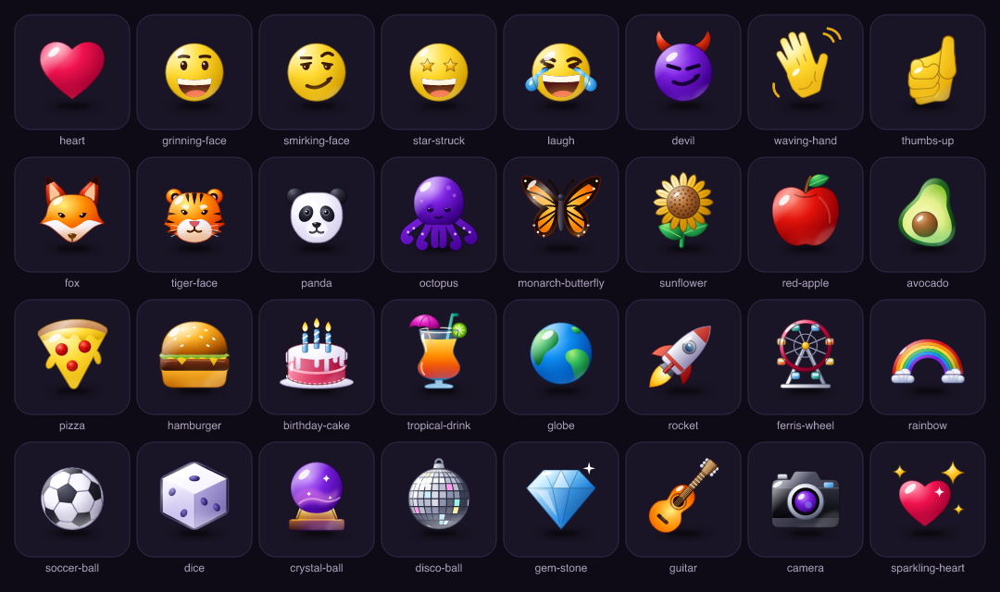

# Gloss Icons

An original glossy icon for every emoji: 1,458 base emoji from Unicode Emoji 18.0, plus a few extras. One light from the top left, a crisp edge, a window reflection, a soft coloured glow at the bottom and a contact shadow, lacquer with a little depth inside. Drawn from scratch as code, not traced from any emoji font or icon set.



Every group has its own contact sheet in [`docs/sheets/`](docs/sheets): smileys, people, animals and nature, food, travel, activities, objects, symbols, flags and extras.

## Use them

Every icon comes as an optimised SVG and as WebP at 32, 64, 128 and 256 px.

```
dist/
  svg/<id>.svg
  webp/32/<id>.webp   webp/64/…   webp/128/…   webp/256/…
  manifest.json        every icon in Unicode order, with its emoji, group, subgroup, tags and file sizes
```

**Mobile apps:** ship the WebP that matches your largest display size (128 px covers ~42 pt at 3x) and draw it with your platform's image view. A bitmap is far cheaper to show in a long list than drawing gradients and blurs at runtime; most icons are 2–5 KB at 128 px.

**Web:** use the SVG for anything that scales, or the WebP in an `` for lists.

### Find an icon by its emoji

Ids are the emoji's CLDR short name in kebab case (`grinning-face`, `red-apple`, `keycap-7`). The manifest maps each emoji to its icon:

```js
const { icons } = require('gloss-icons/dist/manifest.json');
const byEmoji = new Map(icons.map((i) => [i.emoji, i]));
byEmoji.get('🍕'); // { id: 'pizza', emoji: '🍕', group: 'Food & Drink', webp: { 128: 'webp/128/pizza.webp', … }, … }
```

Emoji with variation selectors are stored fully qualified (`❤️`, not `❤`), as in Unicode's `emoji-test.txt`; strip `U+FE0F` from both sides if your input may lack it.

A few ids predate the emoji set and are kept so apps that already use them don't break: `heart` (❤️), `laugh` (😂), `devil` (😈), `dizzy` (😵‍💫), `peek` (🫣), `person` (👤), `satellite` (📡) and others. Because those names were taken, 💫 is `dizzy-star`, 🧑 is `adult` and 🛰️ is `space-satellite`. `data/emoji.json` lists every emoji with its id.

### What's covered

Every fully-qualified emoji in Emoji 18.0, except skin-tone variants, man/woman/hair variants of a person emoji (the neutral person is drawn), the right-facing copies of walkers and runners, and country and subdivision flags. People are drawn in the default yellow.

## Add or change an icon

Each icon is one small file in `icons/` that only describes shape and colour:

```js
module.exports = {
  id: 'heart',
  name: 'Heart',
  emoji: '❤️',
  group: 'Smileys & Emotion',
  subgroup: 'heart',
  tags: ['love', 'romance'],
  tone: 'pink',            // palette of the main body: sets the edge and inner glow colour
  body: 'M48 80 C22 62 …', // silhouette, used for the outline and to keep reflections inside
  shine: [29, 31, -40],    // where light catches the upper-left curve: x, y, rotation
  draw: (c) => `<path d="…" fill="${c.radial('a', 'pink')}"/>`,
};
```

Light, gloss, outline, glow and shadow all live in `src/engine.js`, so every icon matches and a style change is one edit. Colour ramps are in `src/palettes.js`. Shared parts live in `src/parts/`: `face.js` (the smiley head, eyes, brows and mouths), `skin.js` (skin colour, and `union()` to merge a palm and fingers into one outline), `hand.js`, `person.js` and `figure.js` for people, and one module per family of icons (clocks, buttons and lettering, signs, vehicles, buildings, balls and so on).

```sh
npm install
npm run build                                          # dist/, docs/sheet.png and docs/sheets/
node scripts/build.js --only heart,dice --out /tmp/sheet.png   # quick preview while drawing
node scripts/build.js --only heart --px 64 --out /tmp/small.png   # check it reads small
node scripts/emoji-fields.js red-apple                 # the id/name/emoji/group lines for a new icon
node scripts/emoji-fields.js --subgroup food-fruit     # emoji in a subgroup with no icon yet
node scripts/emoji-data.js                             # rebuild data/emoji.json from Unicode's latest list
```

## Licence

MIT. Use them in anything, commercial included. Emoji names, groups and order come from Unicode's public emoji data.
